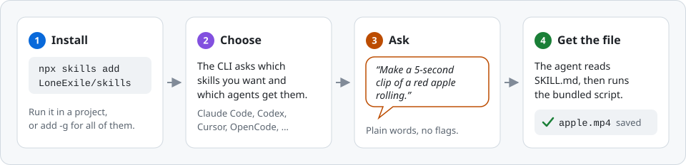

# LoneExile/skills

[](https://github.com/LoneExile/skills/releases/latest)
[](https://github.com/LoneExile/skills/actions/workflows/validate.yml)
[](https://github.com/LoneExile/skills/actions/workflows/skillspector.yml)
[](LICENSE)

Five [Agent Skills](https://agentskills.io) that give your AI coding agent new jobs: make images, videos and voiceovers with Grok, turn sources into highlighted reference cards, and record terminal demos.

## Install

```bash
npx skills add LoneExile/skills
```

Run it in your project. The [`skills` CLI](https://github.com/vercel-labs/skills) asks which skills you want and which agents get them: Claude Code, Codex, Cursor, OpenCode and [many more](https://github.com/vercel-labs/skills/blob/main/docs/agents.md). It needs Node.js 22.20 or later.

Then ask your agent in plain words, for example: *"Make a hero image of a minimal isometric server room."*



<details>
<summary>More ways to install</summary>

```bash
npx skills add LoneExile/skills --list                              # see the skills first
npx skills add LoneExile/skills --skill grok-image                  # just one skill
npx skills add LoneExile/skills --skill grok-image -a claude-code   # one skill, one agent
npx skills add LoneExile/skills -g                                  # for all your projects
npx skills update                                                   # get the latest later
```

There's no package to publish: this repo is the source. Each [release](https://github.com/LoneExile/skills/releases) also has zip files of every skill.

</details>

## What each skill does


### grok-image

Makes an image from a text prompt with xAI's Grok Imagine and saves it as a file.

- **Try:** *"Make a hero image of a minimal isometric server room with a blue accent."*
- **Needs:** Python 3.9 or newer and an xAI sign-in: an API key or the `grok` CLI login ([how it finds them](#how-the-grok-skills-sign-in)).
- **By hand:** `python3 <skill-dir>/grok_image.py "a minimal isometric server room" --out ./hero.jpg`

### grok-video

Makes an MP4 clip of 1 to 15 seconds from a prompt, a start image, or both. A clip usually takes 30 to 90 seconds to make.

- **Try:** *"Make a 5-second clip of a red apple rolling across a wooden table."*
- **Needs:** Python 3.9 or newer and an xAI sign-in ([how it finds them](#how-the-grok-skills-sign-in)).
- **By hand:** `python3 <skill-dir>/grok_video.py "a red apple rolling across a wooden table" --duration 5 --out ./apple.mp4`

### grok-tts

Turns text into a Grok voiceover (WAV or MP3) with the time of every word. For a whole script it writes `lines.json`, ready for HyperFrames' `media-use`. Results are cached, so a repeat run costs nothing.

- **Try:** *"Voice this with Grok: 'Meet Frame, the video editor that listens.'"*
- **Needs:** Python 3.9 or newer and an xAI API key or the `grok` CLI login ([how it finds them](#how-the-grok-skills-sign-in)). Credit the voice as AI-generated by xAI Grok.
- **By hand:** `python3 <skill-dir>/grok_tts.py "Meet Frame." -o voice.wav --words voice.words.json`

### highlighted-source-reference-cards

Backs up your numbers. It turns the web pages and PDF pages behind a bid, BOM or diagram into PNG cards: the page with its URL and capture date, and the exact lines that support each number highlighted in pink. A card is written only when every highlight is found.

- **Try:** *"Make reference cards for the prices in this BOM."*
- **Needs:** Node 20 or newer, Chrome (or Chromium, Edge, Brave), and poppler for PDFs (`brew install poppler`).
- **By hand:** `node <skill-dir>/refcards.mjs probe spec.json` checks every highlight, then `node <skill-dir>/refcards.mjs build spec.json --out ./references` writes the cards.

### terminal-demo-video

Records a real terminal session as a looping GIF and MP4. It types into your program through tmux, so even Alt and Ctrl shortcuts reach it, which VHS drops.

- **Try:** *"Record a 20-second demo of my CLI for the README."*
- **Needs:** `tmux`, `asciinema`, `agg` and `ffmpeg` (`brew install tmux asciinema agg ffmpeg`).
- **By hand:** `<skill-dir>/record.sh --cmd "my-cli" --out ./demo --actions demo.actions`

## How the Grok skills sign in

The three Grok skills find your xAI credential themselves. Give them one of these:

- an xAI API key in `XAI_API_KEY` or `GROK_API_KEY`, or as a line like `XAI_API_KEY=xai-...` in `~/.omp/.env` (the scripts read that file even outside OMP);
- or the [`grok` CLI](https://github.com/superagent-ai/grok-cli), logged in.


Every run prints `Key: <source>` on stderr. That is the xAI account the run is billed to. Never paste a key into a chat or onto a command line.

`grok-image` and `grok-video` use Grok's Imagine endpoints, which xAI doesn't document as a public API, so they may change without notice.

## What's in the repo

```text
skills/<name>/SKILL.md     what the agent reads
skills/<name>/<script>     the helper it runs (Python, Node or Bash)
tests/                     offline tests for the Grok scripts
assets/                    the diagrams on this page
```

CI checks every `SKILL.md`, runs the tests on Python 3.9 and 3.12, and scans the skills with NVIDIA's [SkillSpector](https://github.com/NVIDIA/SkillSpector).

## License

[MIT](LICENSE)
